# Password Cracking with John the Ripper (JTR) & Johnny GUI

A hands-on cybersecurity lab from **Networkwalks Academy** — cracking the password on a protected PDF using **John the Ripper (JTR)** and its GUI front-end, **Johnny**, on Windows.

> ⚠️ **Ethical use only.** This exercise was performed in a controlled training environment against a file I was explicitly authorized to test. Password cracking tools must only be used on systems/files you own or have written permission to assess.

---

## 🧠 What I learned

- How **John the Ripper** and **Johnny** work together — JTR does the cracking, Johnny gives it a GUI so you don't need to memorize CLI flags.
- How to pull a crackable **hash** out of a password-protected PDF (the same format used by `pdf2john`/`pdf2hashcat`).
- How a dictionary/brute-force attack recovers a plaintext password from that hash.
- Why weak, common passwords (dictionary words, keyboard patterns) fall almost instantly to this kind of attack — and why that matters for real-world password policy.

---

## 🛠️ Tools Used

| Tool | Purpose |
|---|---|
| [John the Ripper](https://www.openwall.com/john/) | Core password-cracking engine |
| [Johnny](https://openwall.info/wiki/john/johnny) | GUI front-end for JTR |
| Online PDF hash extractor | Converts the locked PDF into a JTR-compatible hash |
| Notepad | Save the extracted hash to a `.txt` file |

---

## 🚶 Step-by-Step Walkthrough

### Step 1 — Install John the Ripper
Downloaded the Windows build of JTR (jumbo version) from the official site.

### Step 2 — Install & configure Johnny
Downloaded and installed Johnny, the GUI for JTR.

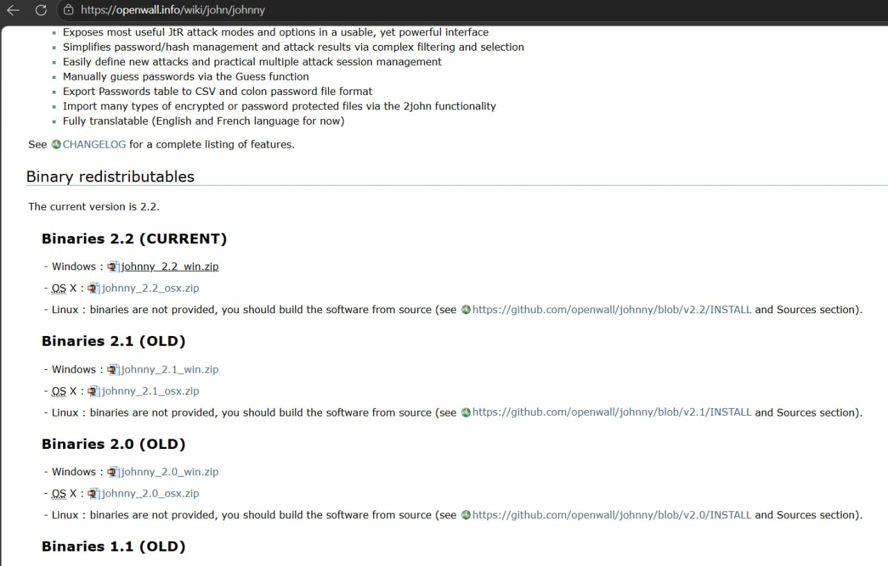
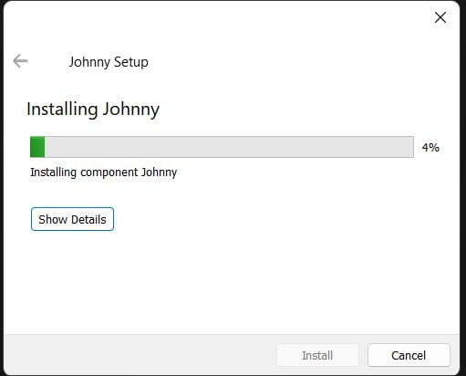

On first launch, Johnny has no JTR executable configured yet:

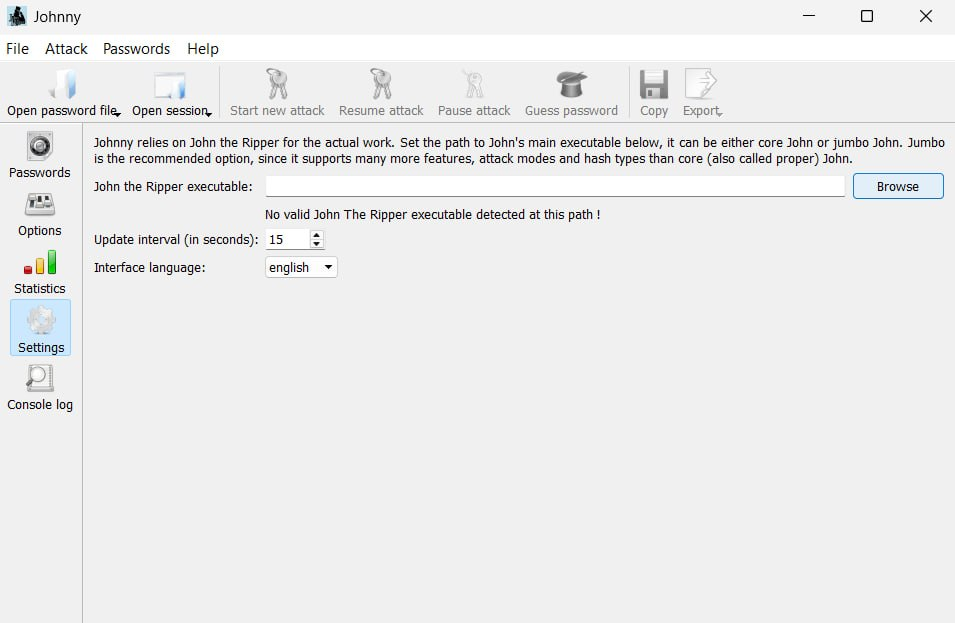

Pointed Johnny at `john.exe` inside the extracted JTR `run` folder, so it could detect and use the engine:

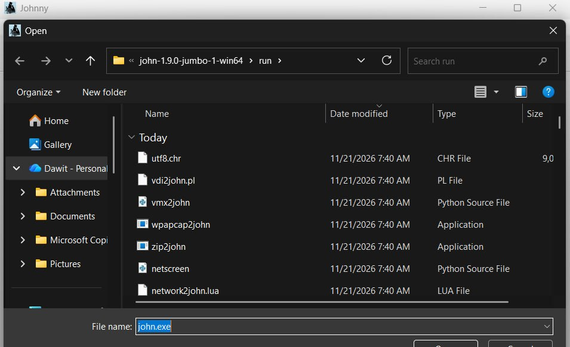
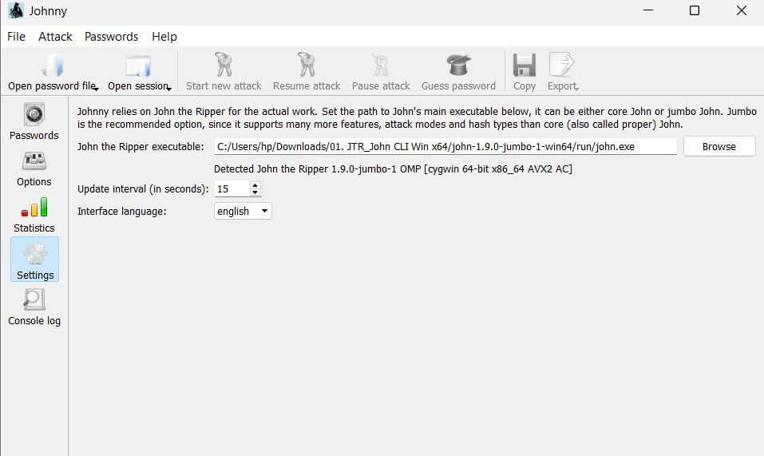

### Step 3 — Extract the hash from the locked PDF
Uploaded the protected file (`My Locked PDF1.pdf`) to an online PDF-hash-extraction tool, which outputs the hash in the same format JTR's `pdf2john` utility produces.

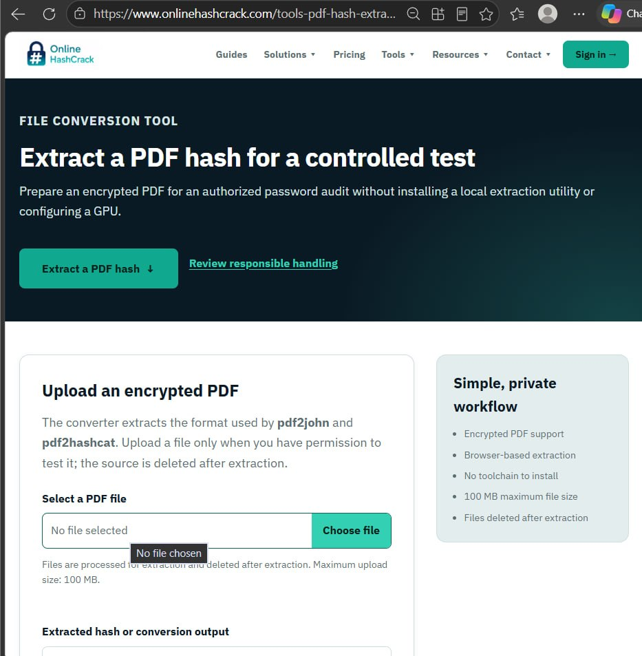
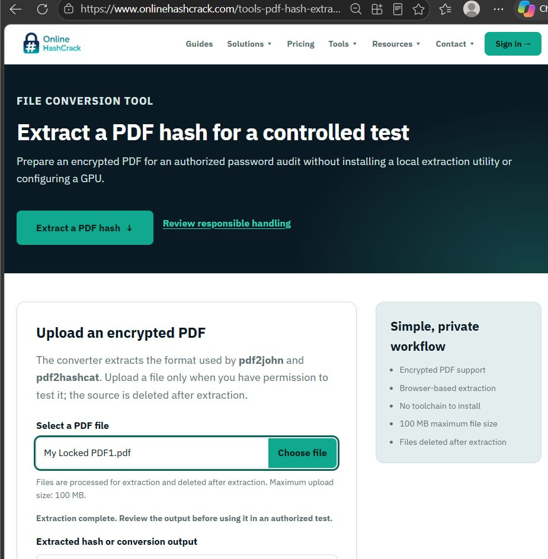

Copied the extracted `$pdf$...` hash value:

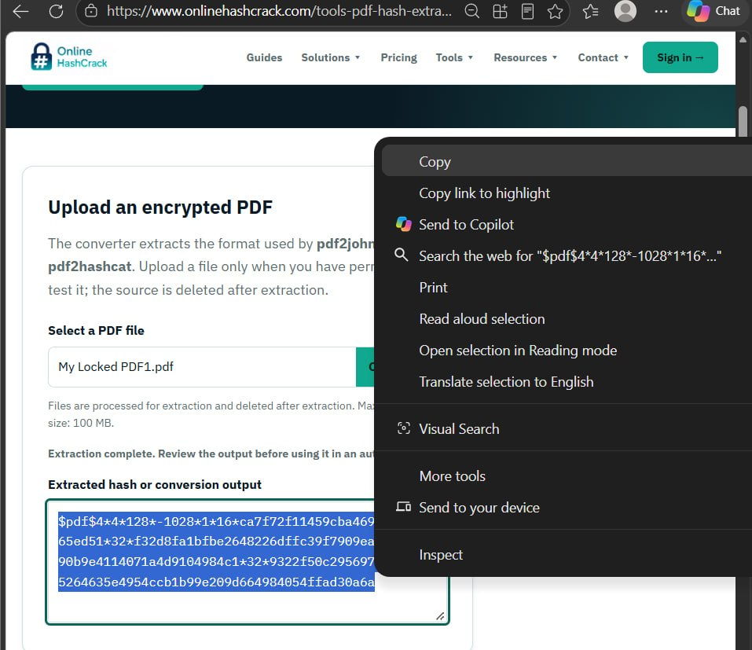

Pasted it into Notepad and saved it as `hash1.txt` (making sure no stray characters like a leading `b'` were left in from copy/paste):

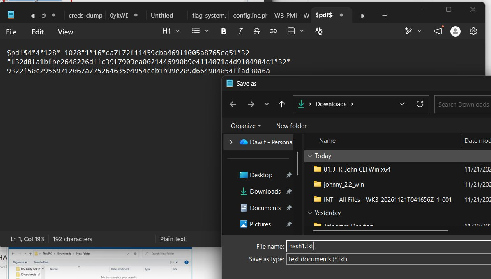

### Step 4 — Load the hash into Johnny and attack
Opened the saved hash file inside Johnny:

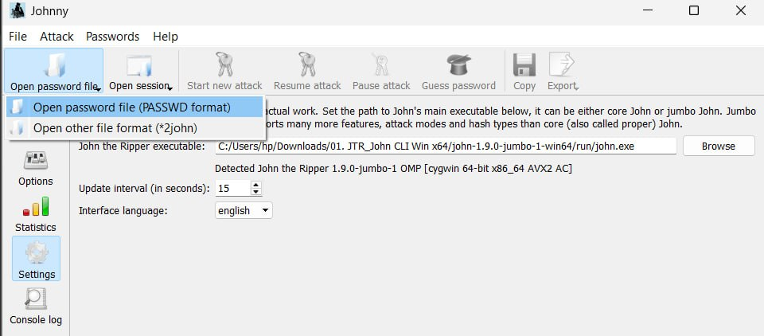
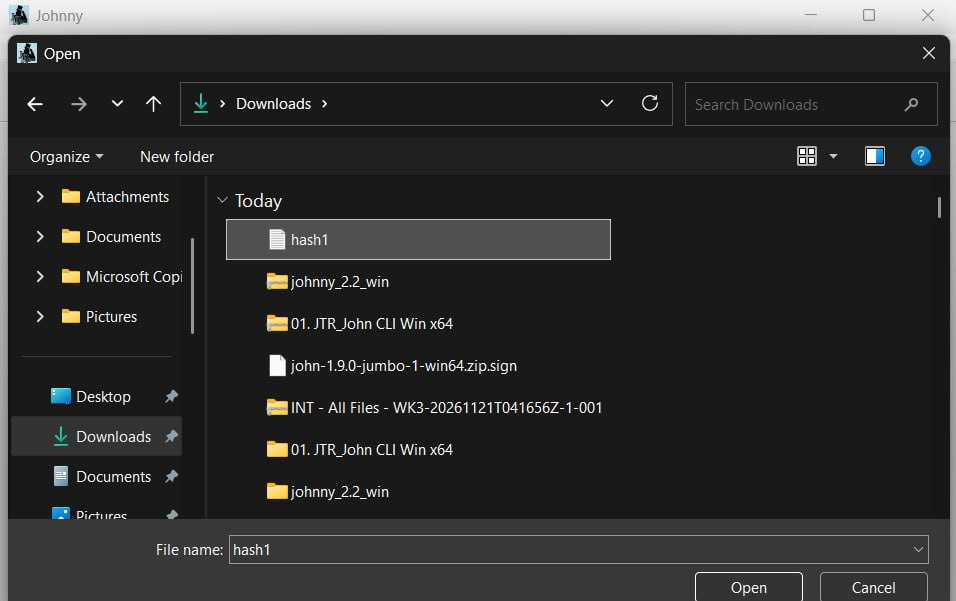

Started the attack:

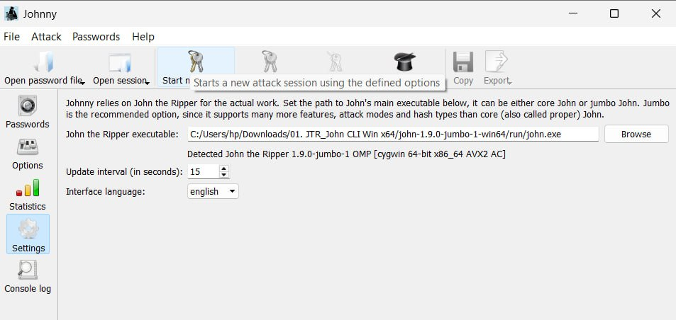

JTR cracked the hash and recovered the plaintext password:

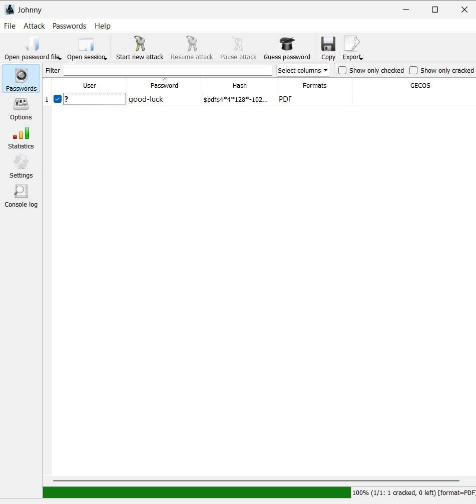

### Step 5 — Unlock the PDF
Opened the originally locked PDF, entered the recovered password at the prompt, and the document opened successfully.

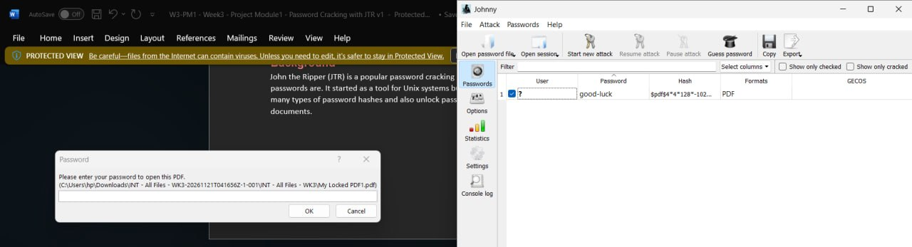
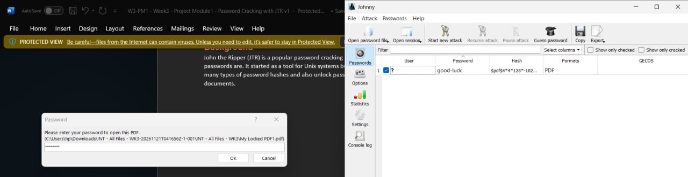

✅ **Result:** PDF unlocked, lab objective completed.

---
Author :
Dawit Nigus Mamo

## 🔑 Key Takeaway

This lab is a good reminder that document-level password protection is only as strong as the password itself — a hash extracted from a protected PDF can be cracked offline, at speed, the moment the password is weak or guessable. Strong, unique, high-entropy passwords (or better, passphrase + proper encryption key management) are what actually hold up against this class of attack.

---

## 📚 Reference

Lab: *Week 3 – Project Module 1: Password Cracking with JTR* — Networkwalks Academy
🔗 [www.networkwalks.com](https://www.networkwalks.com)
